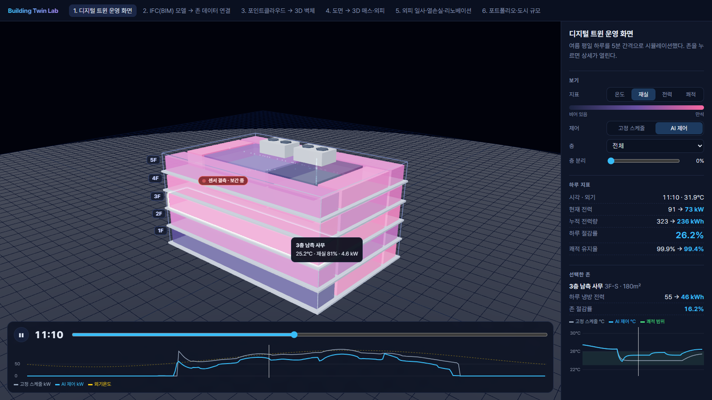
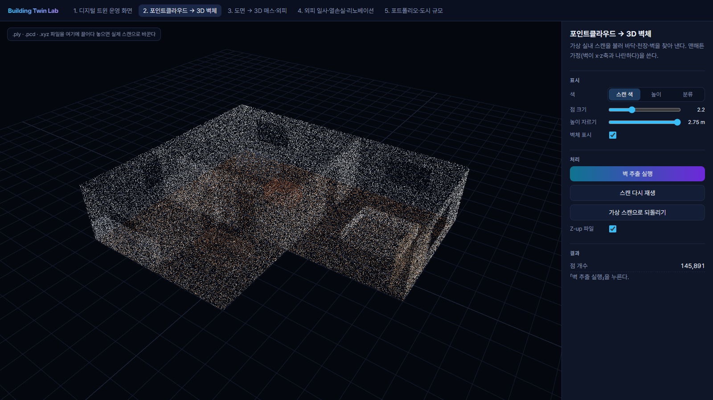
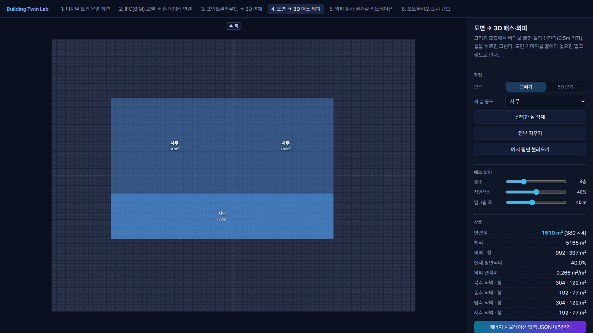
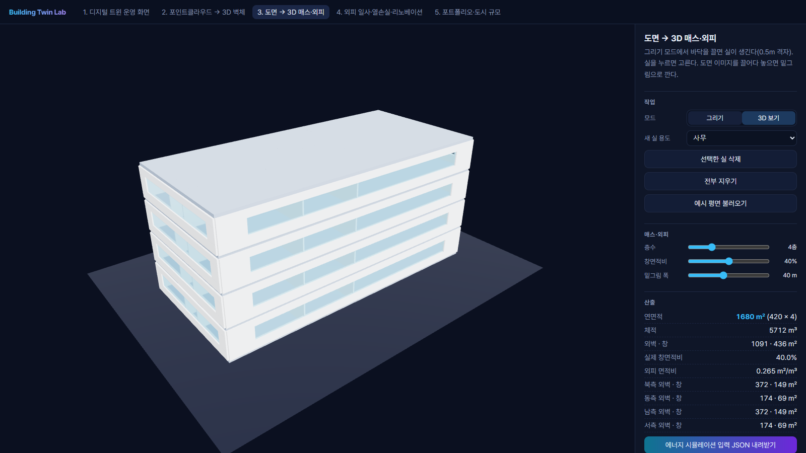
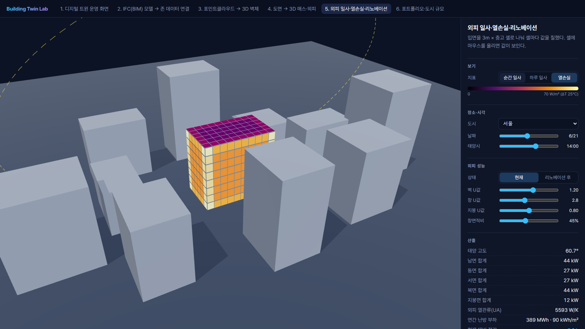
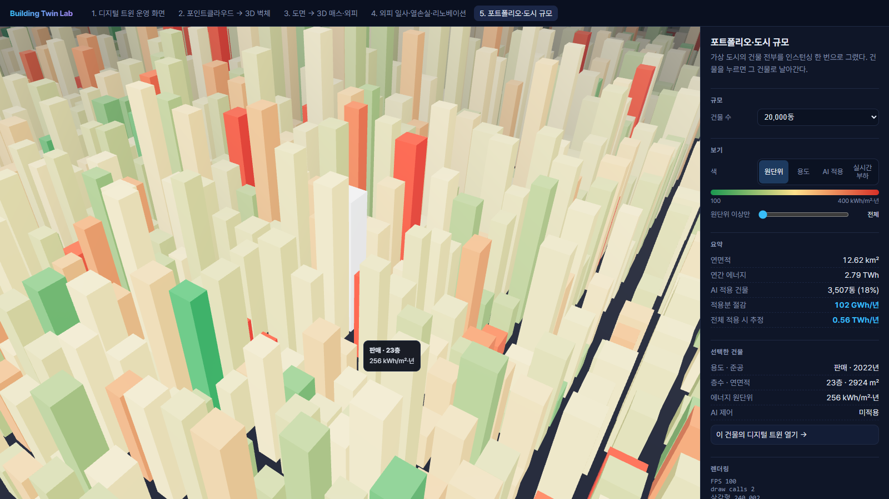

<div align="center">


# Building Twin Lab

**스마트 건물관리 PoC를 위한 WebGL·Three.js 연구 실험실**

AI 건물 에너지 운영 플랫폼에 붙일 웹 3D 화면을 미리 만들어 보고, 그 과정에서 얻은 지식을 남기는 저장소입니다.

`three 0.187` · `Vite 8` · `TypeScript 7` · 프레임워크 없음 · 모든 데이터는 가상 데이터

**[▶ 라이브 데모](https://webcodur.github.io/building-twin-lab/)** · [실험 다섯 가지](#실험-다섯-가지) · [시작하기](#시작하기) · [연구 노트](docs/01-threejs-webgl-notes.md) · [PoC 아이디어](docs/02-poc-ideas.md)

</div>

---

## 왜 만들었나

AI가 건물 냉난방을 자율 제어해 에너지를 아낀다는 말은, 운영자에게는 블랙박스입니다. 이 실험실은 그 블랙박스를 **공간 위에 펼쳐 보이는 방법**을 미리 검증합니다.

- 어느 층, 어느 존을, 언제, 얼마나 아꼈는가
- 고객 건물을 도면·스캔에서 얼마나 빨리 3D로 옮길 수 있는가
- 리노베이션 전후를 투자자가 이해하는 그림으로 보여 줄 수 있는가
- 한 동에서 수만 동까지 같은 화면이 버티는가

## 실험 다섯 가지

### 1. 디지털 트윈 운영 화면 — 운영·제어

 

5층 업무시설의 30개 존을 여름 평일 하루(5분 간격 288스텝) 동안 시뮬레이션합니다. **고정 스케줄**과 **AI 제어**(재실 예측 기반 기동·정지, 비재실 셋백, 아침 예냉, 재실 기반 외기 도입량 제어, 팬 변속)를 같은 시각에 비교합니다.

- 지표 전환: 온도 · 재실 · 전력 · 쾌적
- 층 분리·층 고립, 존 선택 시 외곽선 강조와 존별 온도 그래프
- 옥상 공조기 → 샤프트 → 존으로 흐르는 급기 입자. 입자 속도는 부하에 비례합니다
- 센서 결측 구간 경보와 보간 표시
- 결과: 하루 냉방 전력 **1,104 → 814 kWh(−26.2%)**, 쾌적 유지율 99.9% → 99.4%

### 2. 포인트클라우드 → 3D 벽체 — 건물 DX 자동화

 

가상 실내 스캔(약 14.6만 점)을 스캐너에서 퍼져 나가는 파면으로 드러냅니다. 그 뒤 브라우저 안에서 다음을 자동으로 찾습니다.

1. 높이 히스토그램으로 바닥·천장 높이
2. 평면 격자에 쌓인 점의 세로 분포로 벽 셀(가구는 낮게 쌓여 걸러집니다)
3. 행·열 방향 연속 구간을 선분으로 합쳐 벽체

결과는 벽 15개, 바닥 면적 100.7㎡(실제 100㎡), 처리 시간 8ms입니다. `.ply` · `.pcd` · `.xyz` 파일을 끌어다 놓으면 실제 스캔으로 바꿉니다.

### 3. 도면 → 3D 매스·외피 — 건물 DX 자동화

 

도면 이미지를 밑그림으로 깔고 실을 그리면 0.5m 격자로 래스터화합니다. 격자에서 외벽과 내벽을 판정하고 외벽에만 창 띠를 냅니다. 층수와 창면적비를 바꾸면 즉시 다시 만듭니다. 방위별 외벽·창 면적, 연면적, 체적, 외피 면적비를 **에너지 시뮬레이션 입력 JSON**으로 내려받습니다.

### 4. 외피 일사·열손실·리노베이션 — 진단·ESG

 

서울·파리·바르셀로나의 날짜·태양시에 따라 태양 궤적과 그림자를 그립니다. 입면을 3m × 층고 셀로 나눠 주변 건물 차폐를 반영한 **순간·하루 일사**를 칠합니다. 열손실 모드는 U값과 모서리·슬래브 단부 열교를 열화상처럼 보여 줍니다. 리노베이션 후 연간 난방 부하는 **−68%**입니다(UA × 난방도일 근사).

### 5. 포트폴리오·도시 규모 — 확장성

 

가상 도시의 건물 1천~10만 동을 `InstancedMesh` 하나로 그립니다. 2만 동에서 draw call 2개, 93 FPS입니다. 원단위·용도·AI 적용 여부로 칠하고, **실시간 부하** 모드에서는 CPU 갱신 없이 셰이더가 인스턴스별 위상으로 색을 움직입니다. 건물을 누르면 그 건물로 날아가 상세 정보와 트윈 링크를 엽니다.

## 시작하기

```bash
pnpm install
pnpm dev          # http://localhost:5180
```

| 명령 | 하는 일 |
|---|---|
| `pnpm dev` | 개발 서버(5180) |
| `pnpm build` | 타입 검사 + 프로덕션 빌드(`dist/`) |
| `git push` (main) | GitHub Actions가 빌드해 GitHub Pages에 배포합니다 |
| `pnpm capture` | 개발 서버를 띄운 상태에서 실험별 조작을 재현해 `media/screens/`를 다시 찍고 콘솔 오류를 보고합니다 |
| `node scripts/record.mjs` | 실험별 동작 영상을 녹화합니다(소개 영상 재료) |
| `npx tsx scripts/sim-check.mts` | 브라우저 없이 시뮬레이션 지표를 출력합니다 |

캡처·녹화에는 로컬 Chrome이 필요합니다. 녹화는 처음 한 번 `npx playwright install ffmpeg`를 실행합니다.

## 구조

```
src/
  core/        무대(렌더러·카메라·루프·정리), 패널, 색 램프, 캔버스 차트, dispose
  data/        가상 건물(층·존·센서 결측)
  sim/         존 단위 1R1C 열 모델과 두 가지 제어 정책
  labs/        실험 다섯 개. 각 실험은 mount(el) → dispose 함수 하나입니다
scripts/       캡처·녹화·시뮬레이션 확인
docs/          연구 노트와 PoC 아이디어
media/
  screens/     README 캡처
  promo/       HyperFrames 소개 영상 프로젝트(장면별 HTML)
  promo.mp4    렌더 결과, promo.webp는 README용 미리보기
```

새 실험을 추가하려면 `src/labs/`에 `Lab` 객체를 만들고 `src/main.ts`의 `LABS` 배열에 넣습니다. 무대(`createStage`)가 렌더러 설정과 정리를 맡으므로 실험 코드는 장면에만 집중합니다.

## 소개 영상 다시 만들기

`media/promo/`는 [HyperFrames](https://hyperframes.heygen.com) 프로젝트입니다. 장면마다 `compositions/*.html` 파일 하나이며, 재료는 `scripts/record.mjs`로 녹화한 실제 화면입니다.

```bash
cd media/promo
npx hyperframes preview     # 브라우저에서 편집·미리보기
npx hyperframes render -o ../promo.mp4
```

## 문서

- [연구 노트](docs/01-threejs-webgl-notes.md): 색 관리, 메모리·컨텍스트 수명, 피킹, 인스턴싱, `onBeforeCompile`, 점군 셰이더, 후처리, 태양 계산, 검증 자동화, 다음에 시도할 기술
- [PoC 아이디어](docs/02-poc-ideas.md): 대상 기업 분석, 3D가 필요한 이유, 아이디어 12개, 15분 시연 시나리오, 연동 구조, 일정, 착수 전 확인 사항

## 데이터 안내

화면의 모든 건물·센서·에너지 값은 가상 데이터와 단순 모델에서 나왔습니다. 구조와 화면을 검증하기 위한 값이며, 실제 건물의 성능을 뜻하지 않습니다.
