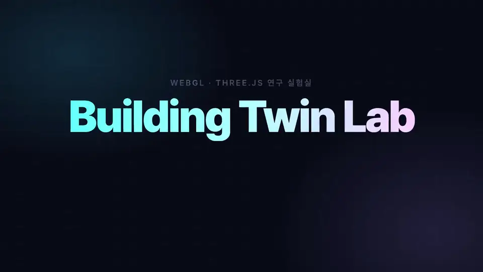
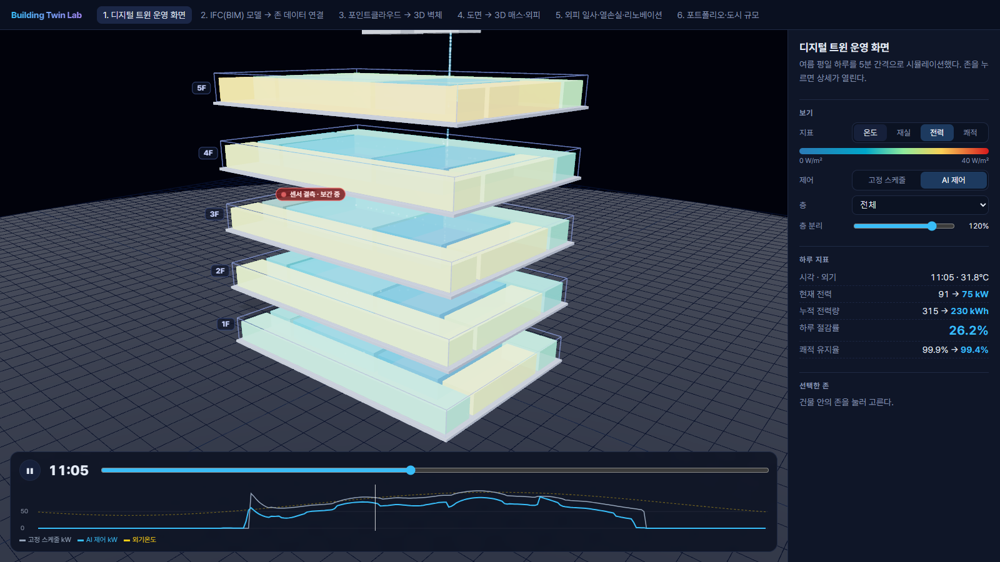
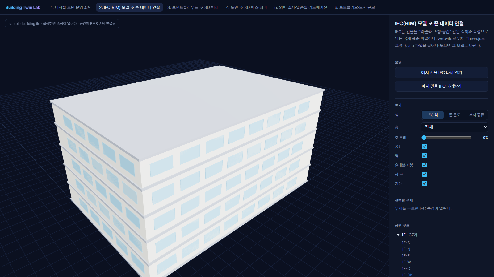
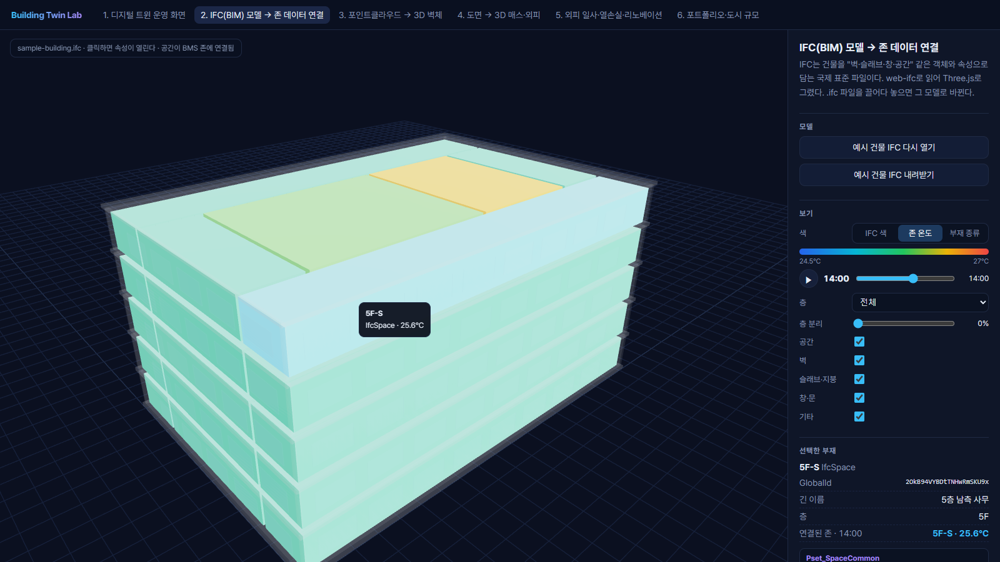
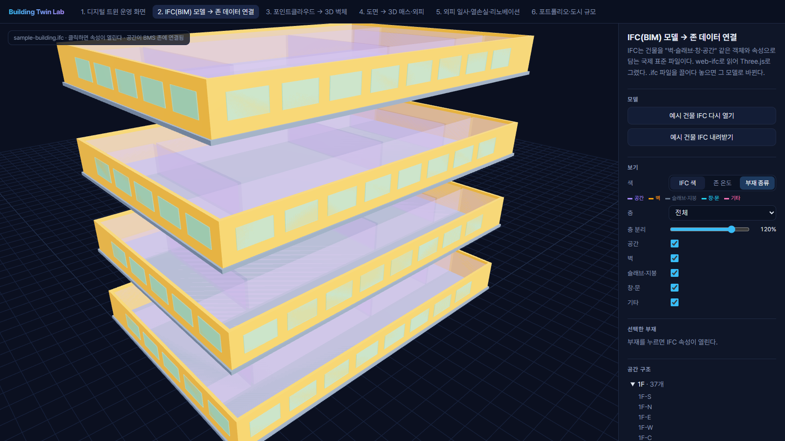
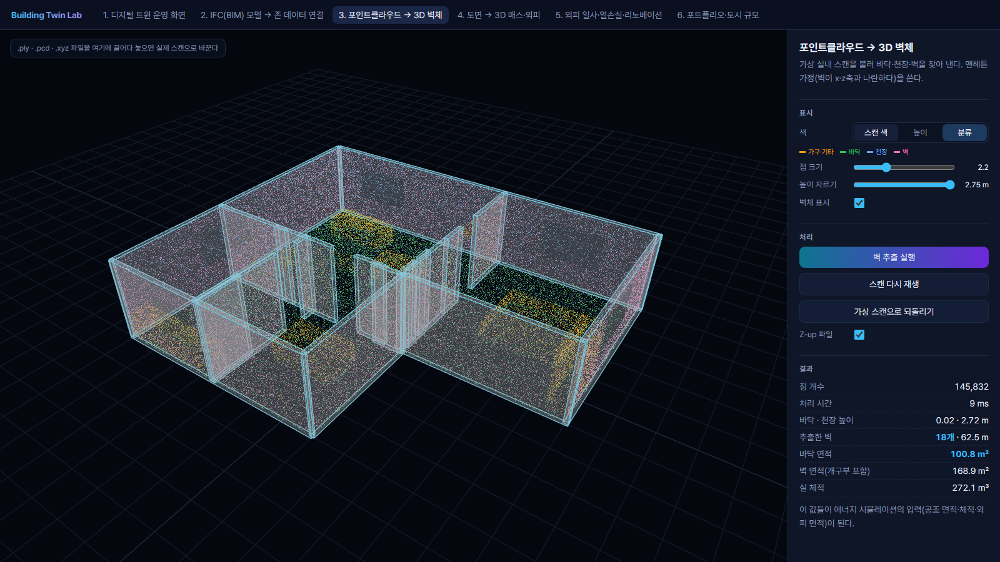
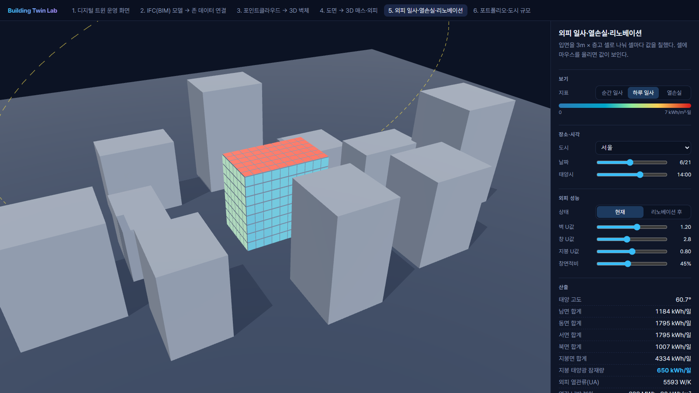
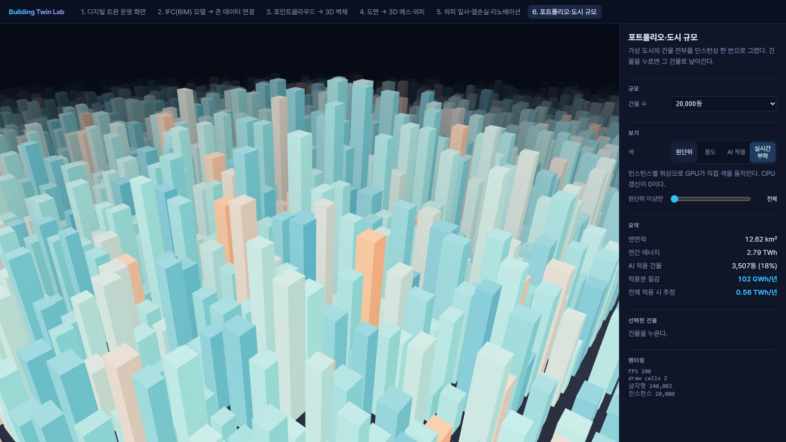

<div align="center">



# Building Twin Lab

**건물을 웹 브라우저 안에서 3D로 보고, 데이터와 연결해 보는 실험실**

**[▶ 바로 써 보기 (라이브 데모)](https://webcodur.github.io/building-twin-lab/)**

설치 없이 크롬·엣지에서 바로 열립니다. 모든 건물과 숫자는 실험용 가상 데이터입니다.

</div>

---

## 목차

1. [한눈에 보기](#1-한눈에-보기)
2. [실험 여섯 가지](#2-실험-여섯-가지)
3. [3D 웹 기술, 쉽게 이해하기](#3-3d-웹-기술-쉽게-이해하기)
4. [건물 쪽 용어, 쉽게 이해하기](#4-건물-쪽-용어-쉽게-이해하기)
5. [만들면서 내린 판단](#5-만들면서-내린-판단)
6. [자주 받는 질문](#6-자주-받는-질문)
7. [직접 실행하기](#7-직접-실행하기)

---

## 1. 한눈에 보기

요즘 큰 건물은 냉난방을 AI가 알아서 조절하게 만드는 추세입니다. 그런데 관리자 입장에서 "AI가 알아서 아꼈다"는 말은 믿기 어렵습니다. **어느 층, 어느 방을, 언제, 왜** 그렇게 했는지 눈으로 보여야 믿을 수 있습니다.

이 실험실은 그 "눈으로 보여 주는 화면"을 미리 만들어 본 것입니다.

| 질문 | 답하는 실험 |
|---|---|
| AI가 어디서 얼마나 아꼈나요? | 1. 디지털 트윈 운영 화면 |
| 설계 도면 파일(BIM)을 그대로 쓸 수 있나요? | 2. IFC(BIM) 모델 → 존 데이터 연결 |
| 도면이 없는 오래된 건물은요? | 3. 포인트클라우드 → 3D 벽체, 4. 도면 → 3D |
| 리노베이션하면 얼마나 좋아지나요? | 5. 외피 일사·열손실·리노베이션 |
| 건물이 수천, 수만 개면요? | 6. 포트폴리오·도시 규모 |

---

## 2. 실험 여섯 가지

### 1. 디지털 트윈 운영 화면

 

**무엇을 보나요?** 5층 사무 건물 하나를 30개의 방(존)으로 나누고, 여름 하루 24시간을 재생합니다. 방마다 온도·사람 수·전기 사용량을 색으로 칠합니다.

**왜 필요한가요?** 같은 하루를 두 방식으로 운영해 비교합니다.
- **고정 스케줄**: 아침 7시부터 저녁 8시까지 모든 방을 24℃로 맞춥니다. 빈 회의실도 똑같이 냉방합니다.
- **AI 제어**: 사람이 올 시간을 예측해 미리 켜고, 빈 방은 덜 식히고, 바깥이 시원한 아침에 미리 식혀 둡니다.

그 결과 하루 냉방 전기는 **1,104 → 814 kWh로 26% 줄고**, 쾌적한 온도를 지킨 비율은 99.9% → 99.4%입니다. 아끼면서도 덥지 않다는 것을 한 화면에서 보여 줍니다.

**해 볼 것**: 아래 재생 막대를 움직여 보세요. 「층 분리」로 층을 띄워 보고, 방을 눌러 그 방의 하루 온도 그래프를 보세요. 빨간 「센서 결측」 표시는 센서 데이터가 끊긴 구간을 숨기지 않고 알리는 기능입니다.

### 2. IFC(BIM) 모델 → 존 데이터 연결

 

**무엇을 보나요?** 건물 설계 표준 파일인 **IFC**를 브라우저에서 열어 3D로 보여 줍니다. 층 → 방 → 벽·창·슬래브 순서로 건물 구조를 탐색하고, 아무 부재나 누르면 그 부재에 담긴 정보(열관류율, 면적, 고유 번호 등)가 나옵니다.

**왜 필요한가요?** 실제 건물에는 설계 단계에서 만든 BIM 데이터가 이미 있는 경우가 많습니다. 이 파일을 그대로 읽을 수 있으면 3D 모델을 새로 만들 필요가 없습니다. 이 실험의 핵심은 **IFC 안의 "방(IfcSpace)"과 냉난방 제어 시스템의 "존"을 연결**하는 것입니다. 연결되면 설계 도면 위에 실시간 온도를 칠할 수 있습니다.



- 예시 건물은 디지털 트윈과 같은 건물을 **표준 IFC4 파일로 직접 생성**한 것입니다. 「예시 건물 IFC 내려받기」로 받아 다른 BIM 프로그램에서도 열 수 있습니다.
- 방마다 `Pset_BmsLink`라는 정보 묶음을 넣어, 어느 공조기의 어느 온도 센서와 연결되는지 적어 두었습니다.
- 132KB 파일, 부재 186개를 읽고 3D로 만드는 데 약 40ms가 걸립니다.

**해 볼 것**: 「존 온도」를 누르고 재생 버튼을 눌러 보세요. 방 색이 시간에 따라 바뀝니다. 가지고 있는 `.ifc` 파일을 화면에 끌어다 놓으면 그 건물로 바뀝니다.

### 3. 포인트클라우드 → 3D 벽체

 

**무엇을 보나요?** 레이저 스캐너로 방을 찍으면 수십만 개의 점(포인트클라우드)이 나옵니다. 이 실험은 약 14만 6천 개의 점에서 **바닥·천장·벽을 자동으로 찾아** 벽체 모델을 만들고, 바닥 면적과 부피를 계산합니다.

**왜 필요한가요?** 오래된 건물은 BIM 파일이 없습니다. 스캔 한 번으로 에너지 계산에 필요한 면적·부피를 얻을 수 있으면 도입이 빨라집니다.

**원리(쉬운 말)**
1. 점의 높이를 세어 보면 바닥과 천장 높이에 점이 몰려 있습니다. 그 높이를 바닥·천장으로 봅니다.
2. 위에서 내려다본 격자에 점을 쌓습니다. 벽은 바닥부터 천장까지 세로로 길게 쌓이고, 소파·책상은 낮게 쌓입니다. 길게 쌓인 칸만 벽으로 봅니다.
3. 이어진 벽 칸을 선으로 묶어 벽체를 세웁니다.

실제 바닥 면적 100㎡에 대해 100.8㎡를 약 10ms(0.01초)에 계산합니다. `.ply`·`.pcd`·`.xyz` 스캔 파일을 끌어다 놓아도 됩니다.

### 4. 도면 → 3D 매스·외피

 

**무엇을 보나요?** 도면 이미지를 바닥에 깔고 방을 사각형으로 그리면, 바깥벽과 안쪽 벽을 스스로 구분하고 바깥벽에만 창을 냅니다. 층수와 창 크기를 바꾸면 바로 다시 만들어집니다.

**왜 필요한가요?** 에너지 계산에는 "남쪽 벽이 몇㎡, 그중 창이 몇㎡" 같은 숫자가 필요합니다. 이 실험은 그 숫자를 방향별로 계산해 **에너지 시뮬레이션 입력 파일(JSON)**로 내려받게 합니다.

### 5. 외피 일사·열손실·리노베이션

 

**무엇을 보나요?** 서울·파리·바르셀로나 중 도시와 날짜·시각을 고르면, 해의 위치와 주변 건물 그림자를 계산해 건물 겉면 칸마다 햇빛을 얼마나 받는지 칠합니다. 「열손실」로 바꾸면 겨울에 열이 새는 곳을 열화상 카메라처럼 보여 줍니다. 모서리처럼 열이 더 새는 곳(열교)이 밝게 드러납니다.

**왜 필요한가요?** 유럽은 오래된 건물의 단열 개선(리노베이션)을 강하게 요구합니다. 「리노베이션 후」를 누르면 벽·창·지붕 단열 성능이 바뀌고, 연간 난방 에너지가 **약 68% 줄어드는** 것을 보여 줍니다(단순 근사 계산).

### 6. 포트폴리오·도시 규모

 

**무엇을 보나요?** 가상 도시의 건물 1천~10만 동을 한꺼번에 그립니다. 에너지를 많이 쓰는 건물, AI 제어를 적용한 건물을 색으로 구분하고, 건물을 누르면 그 건물로 카메라가 날아갑니다.

**왜 필요한가요?** 건물을 여러 채 가진 회사나 도시는 "어느 건물부터 손봐야 하나"를 한눈에 봐야 합니다. 2만 동을 그려도 그래픽카드에 보내는 그리기 명령은 **2번**이고, 화면은 초당 90장 이상으로 부드럽게 움직입니다(비결은 아래 [인스턴싱](#3-3d-웹-기술-쉽게-이해하기) 참고).

---

## 3. 3D 웹 기술, 쉽게 이해하기

| 용어 | 쉬운 설명 |
|---|---|
| **WebGL** | 웹 브라우저가 컴퓨터의 그래픽카드(GPU)를 직접 쓰게 해 주는 통로입니다. 그래서 설치 없이 웹에서 3D가 돌아갑니다. |
| **Three.js** | WebGL을 쉽게 쓰게 해 주는 도구 상자입니다. WebGL만으로는 삼각형 하나 그리는 데도 수십 줄이 필요한데, Three.js는 "상자 하나 놓아 줘" 수준으로 줄여 줍니다. |
| **장면·카메라·조명** | 영화 촬영장과 같습니다. 장면(Scene)에 물건을 놓고, 조명을 켜고, 카메라로 찍습니다. |
| **메시(Mesh)** | 화면에 보이는 물건 하나입니다. **모양(지오메트리)**과 **겉모습(재질)**의 조합입니다. 같은 상자 모양에 유리 재질을 입히면 유리 상자가 됩니다. |
| **렌더 루프** | 만화책을 빠르게 넘기면 움직이는 것처럼, 1초에 60장 정도 그림을 새로 그려 움직임을 만듭니다. |
| **draw call** | CPU가 그래픽카드에 "이거 그려" 하고 보내는 주문서입니다. 택배와 같아서, 상자 1만 개를 1만 번 따로 보내면 느리고 한 번에 묶어 보내면 빠릅니다. **3D 성능은 대부분 이 횟수로 결정됩니다.** |
| **인스턴싱** | 같은 모양을 위치·색만 바꿔 한 번의 주문으로 여러 개 그리는 방법입니다. 도시 2만 동이 주문 2번으로 그려지는 비결입니다. |
| **셰이더** | 그래픽카드 안에서 점마다, 픽셀마다 실행되는 아주 작은 프로그램입니다. 수만 개를 동시에 계산하므로, 도시 전체 색을 매 순간 바꾸는 일도 CPU를 거의 쓰지 않고 해냅니다. |
| **레이캐스팅** | 마우스 위치에서 화면 안쪽으로 레이저 포인터를 쏴서, 처음 맞는 물건을 찾는 방법입니다. "방을 클릭하면 정보가 나온다"가 이렇게 동작합니다. |
| **색공간·톤매핑** | 화면 밝기를 사람 눈에 맞게 바꾸는 규칙입니다. 이 설정을 빠뜨리면 3D 화면이 탁하거나 하얗게 날아갑니다. |
| **메모리 정리(dispose)** | 그래픽카드에 올린 모양·그림은 자동으로 지워지지 않습니다. 화면을 바꿀 때 직접 치워야 오래 써도 느려지지 않습니다. |
| **WASM(WebAssembly)** | C++ 같은 빠른 언어로 만든 프로그램을 브라우저에서 돌리는 기술입니다. IFC 파일 해석기(web-ifc)가 이것으로 돌아갑니다. |

---

## 4. 건물 쪽 용어, 쉽게 이해하기

| 용어 | 쉬운 설명 |
|---|---|
| **BIM** | 건물을 그림이 아니라 **데이터베이스**로 설계하는 방식입니다. "이 선은 벽이고, 두께 30cm에, 단열 성능은 얼마"까지 담습니다. |
| **IFC** | BIM 데이터를 프로그램끼리 주고받는 **국제 표준 파일 형식**입니다(ISO 16739). 워드 문서의 `.docx`처럼, 건물에는 `.ifc`가 있다고 보면 됩니다. |
| **IfcSpace** | IFC 안의 "방(공간)"입니다. 벽(IfcWall)·창(IfcWindow)처럼 눈에 보이는 부재가 아니라 비어 있는 공간 자체를 뜻하며, 냉난방 존과 연결하기 가장 좋은 단위입니다. |
| **Pset(속성 묶음)** | IFC 부재에 붙는 정보 꾸러미입니다. 예: `Pset_WallCommon`에는 "외벽 여부, 열관류율"이 들어 있습니다. |
| **web-ifc** | IFC 파일을 읽어 3D 모양과 속성을 꺼내 주는 공개 라이브러리입니다. 이 실험실은 이것으로 IFC를 읽고 Three.js로 그립니다. |
| **디지털 트윈** | 실제 건물과 똑같이 움직이는 디지털 쌍둥이입니다. 센서 데이터가 들어오면 화면 속 건물도 같이 바뀝니다. |
| **BMS** | 빌딩 관리 시스템입니다. 건물의 냉난방·조명·센서를 한곳에서 감시하고 조작합니다. |
| **HVAC** | 냉난방·환기·공기조화 설비를 통틀어 부르는 말입니다. 건물 에너지의 가장 큰 몫을 씁니다. |
| **존(Zone)** | 냉난방을 한 단위로 조절하는 구역입니다. 보통 방 하나나 몇 개를 묶습니다. |
| **셋포인트·셋백** | 셋포인트는 목표 온도이고, 셋백은 사람이 없을 때 목표 온도를 느슨하게 풀어 에너지를 아끼는 것입니다. |
| **포인트클라우드** | 레이저 스캐너가 찍은 수십만 개의 점 묶음입니다. 점마다 위치(x, y, z)와 색이 있습니다. |
| **외피·열관류율(U값)** | 외피는 건물의 겉껍질(벽·창·지붕)이고, U값은 열이 얼마나 잘 새는지 나타내는 숫자입니다. 낮을수록 단열이 좋습니다. |

---

## 5. 만들면서 내린 판단

화면 뒤에서 어떤 선택을 했는지 정리합니다. 3D 화면을 실제 서비스에 넣을 때 그대로 쓸 수 있는 판단들입니다.

1. **계산과 화면을 분리했습니다.** 하루치 시뮬레이션을 미리 계산해 두고, 화면은 "지금 몇 시"의 값만 읽습니다. 실제 서비스에서는 이 자리에 센서·AI 서버의 데이터만 꽂으면 되고, 화면 코드는 바뀌지 않습니다.
2. **그리기 주문(draw call)을 먼저 줄였습니다.** 같은 모양은 인스턴싱, 같은 재질은 지오메트리 합치기로 묶었습니다. 그래서 2만 동이 주문 2번입니다.
3. **움직임은 셰이더에 맡겼습니다.** 도시 전체가 깜빡이는 "실시간 부하" 화면은 CPU가 건물마다 색을 바꾸지 않습니다. 그래픽카드가 시간 값 하나만 받아 계산합니다.
4. **IFC의 방(IfcSpace)을 연결 고리로 삼았습니다.** 설계 파일의 방 이름과 제어 시스템의 존 ID를 같은 값으로 맞추고, 연결 정보를 IFC 속성(`Pset_BmsLink`)으로 파일 안에 함께 넣었습니다. 파일 하나로 "어느 방이 어느 센서인지"가 전달됩니다.
5. **IFC 엔진은 단일 스레드판을 썼습니다.** 여러 스레드판은 서버에 특별한 보안 헤더가 필요한데, GitHub Pages 같은 정적 호스팅은 그 헤더를 줄 수 없습니다. 배포 환경에 맞춘 선택입니다.
6. **데이터 결측을 숨기지 않았습니다.** 센서가 끊긴 구간은 회색과 경고로 표시하고, 보간값으로 운영 중임을 알립니다. AI 제어에서 신뢰는 화면의 정직함에서 나옵니다.
7. **매번 같은 결과가 나오게 했습니다.** 가상 데이터도 난수 시드를 고정해, 언제 열어도 같은 숫자가 나옵니다. 시연과 검증이 흔들리지 않습니다.
8. **화면 검사를 자동화했습니다.** 스크립트가 실제 크롬으로 여섯 실험을 하나씩 조작해 캡처하고, 오류가 하나라도 나면 실패로 보고합니다.

---

## 6. 자주 받는 질문

**Q. 3D 화면이 느려지면 무엇부터 보나요?**
측정부터 합니다. 초당 화면 수(FPS), 그리기 주문 수, 삼각형 수를 봅니다. 대부분은 그리기 주문이 많아서 느리므로 인스턴싱·합치기로 줄입니다. 그래도 느리면 화면 해상도를 낮추고, 보이지 않는 동안에는 그리기를 멈춥니다.

**Q. 아주 큰 IFC 파일(수백 MB)은 어떻게 하나요?**
세 가지를 합니다. ① 파일 해석을 웹 워커(별도 스레드)로 옮겨 화면이 멈추지 않게 합니다. ② 같은 모양의 부재(같은 창 100개 등)는 인스턴싱으로 묶습니다. ③ 한 번 해석한 결과는 가벼운 형식(예: That Open의 fragments, glTF)으로 바꿔 저장해 두고, 다음부터는 그것을 엽니다.

**Q. 부재를 클릭하면 정보가 어떻게 나오나요?**
레이캐스팅으로 클릭한 3D 메시를 찾고, 그 메시에 붙여 둔 IFC 고유 번호(expressID)로 IFC 속성을 조회합니다. 3D 모양과 데이터를 번호 하나로 잇는 구조입니다.

**Q. React·Next.js 서비스에 넣으려면요?**
Three.js 장면은 React 상태 밖에 두고, 화면에 붙일 때(mount)와 뗄 때(unmount) 함수 두 개로만 연결합니다. 이 실험실의 실험들이 모두 `mount(el) → 정리 함수` 형태라 그대로 감쌀 수 있습니다. Next.js에서는 서버에서 그리지 않도록 클라이언트에서만 불러옵니다.

**Q. 실제 센서 데이터와는 어떻게 잇나요?**
"BMS 포인트 이름 ↔ 3D 존 ID" 대응표 하나가 핵심입니다. 이 실험실에서는 그 대응을 IFC 방 속성에 넣었습니다. 대응표가 있으면 어떤 건물이든 같은 화면이 돕니다.

**Q. 왜 Three.js를 골랐나요? 다른 선택지는요?**
Three.js는 사용자와 자료가 가장 많고, IFC 생태계(web-ifc, That Open)가 Three.js 위에 있습니다. 지도·지구 규모가 필요하면 Cesium, 게임 엔진급 편집 도구가 필요하면 Babylon.js도 후보입니다. 앞으로는 WebGPU(WebGL의 다음 세대)로 넘어가는 흐름이라, Three.js의 WebGPU 렌더러도 지켜보고 있습니다.

---

## 7. 직접 실행하기

```bash
pnpm install
pnpm dev          # http://localhost:5180
```

| 명령 | 하는 일 |
|---|---|
| `pnpm dev` | 개발 서버를 켭니다 |
| `pnpm build` | 오류 검사 후 배포용 파일(`dist/`)을 만듭니다 |
| `git push` (main) | GitHub Actions가 자동으로 GitHub Pages에 배포합니다 |
| `pnpm capture` | 개발 서버를 켠 상태에서 여섯 실험을 자동 조작해 `media/screens/`를 다시 찍고 오류를 보고합니다 |
| `npx tsx scripts/sim-check.mts` | 냉방 시뮬레이션 결과 숫자를 출력합니다 |
| `npx tsx scripts/ifc-check.mts` | 예시 IFC 파일을 만들어 표준 해석기로 검증합니다 |

```
src/
  core/      3D 무대(렌더러·카메라·정리), 조작 패널, 색 램프, 작은 그래프
  data/      가상 건물, IFC 파일 작성기
  sim/       방 단위 냉방 시뮬레이션(고정 스케줄 vs AI 제어)
  labs/      실험 여섯 개. 각각 mount(el) → 정리 함수 하나입니다
scripts/     자동 캡처·녹화·검증
docs/        더 깊은 기술 노트와 PoC 아이디어
media/       캡처, 소개 영상(HyperFrames 프로젝트 포함)
```

더 깊은 내용은 다음 문서에 있습니다.
- [기술 노트](docs/01-threejs-webgl-notes.md): 개발자용 상세 노트
- [PoC 아이디어](docs/02-poc-ideas.md): 건물 에너지 AI 서비스에 3D를 붙이는 아이디어와 시연 순서

> 화면의 모든 건물·센서·에너지 값은 가상 데이터와 단순화한 계산에서 나왔습니다. 구조와 화면을 검증하기 위한 값이며, 실제 건물의 성능을 뜻하지 않습니다.
